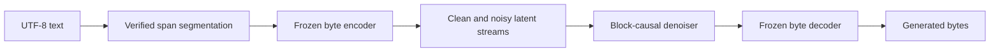

# char-diff

**Decodable byte representations for continuous latent sequence generation.**

An ongoing undergraduate research project on how reconstruction, segmentation,
and diffusion block size interact in language modeling. Variable-length byte
spans are encoded into a frozen 48-dimensional space. A block-causal diffusion
Transformer predicts clean latents, and a byte decoder turns them back into text.

The current multilingual direction compares reconstruction-verified UTF-8 span
segmentation with filtered BPE using a shared 77.6M-parameter denoiser. Completed
TinyStories experiments and the byte-AE results are reported separately below.

## Research questions

- When does a representation that reconstructs well also support generation?
- How do segmentation and block length change conditioning and cost per byte?
- Which latent perturbations cross decoder boundaries, and how do those errors
  differ from loss of semantic coherence during free-running generation?



## Recorded results

| Study | Measurement | Scope |
|---|---|---|
| Diffusion block size | B1 / B4 / B16 next-unit EM: **43.90 / 42.49 / 40.68%** | 64 dev windows, 1,845 anchors, two seeds, 32 denoising steps |
| Full-corpus byte AE | **2,046 / 2,048** exact byte-and-EOS reconstructions | Fixed natural-span calibration panel, 12-language training corpus |
| Character coverage | **5,017 / 5,017** exact reconstructions | Individual codepoints observed in the prepared training corpus |

B1/B4 use a continuation recipe that resets their optimizers; B16 reuses the
existing control. These measurements describe that comparison. Smaller blocks
improve local prediction in this panel but require more model calls. Free text
still exhibits malformed words, repetition, and semantic drift.

See [results and protocols](docs/results.md), [model](docs/method.md),
[reproduction](docs/reproduction.md), and [research status](docs/roadmap.md).

## Source-only quick start

Python 3.10 or later. Install a suitable PyTorch build first, then:

```bash
python -m pip install -e .
python scripts/check_release.py
python scripts/sample.py --help
```

`check_release.py` uses a small randomly initialized CPU model to check the
package and its block mask. It does not load data or pretrained weights.
Sampling a trained model requires the matching codec and checkpoint described
in [reproduction](docs/reproduction.md). Those assets are not bundled in Git.

## Repository

`char_diff/` contains the codec, span search, prior, and training machinery;
`scripts/` contains data, analysis, training, and evaluation entry points;
`configs/` preserves research recipes; `tests/` preserves development checks.
The explicit release manifest records the source snapshot.

## Related work and attribution

The prior builds on block-causal continuous-latent language modeling, including
[AURORA-LM](https://arxiv.org/abs/2608.02602). Byte-level modeling and learned
granularity are also studied by [BLT](https://arxiv.org/abs/2412.09871) and
[H-Net](https://arxiv.org/abs/2507.07955). The local span AE and verified-path
experiments explore a different representation and segmentation interface.

Original release code uses the MIT license. Vendored byte-AE utilities retain
their own MIT notice; see [third-party notices](THIRD_PARTY_NOTICES.md).
This repository is research software; cite the software using `CITATION.cff`.
